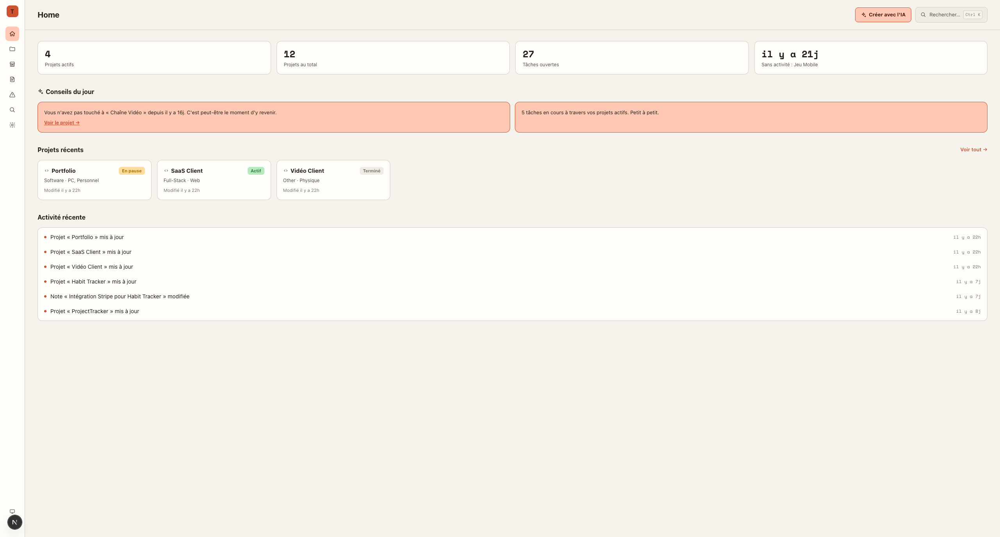
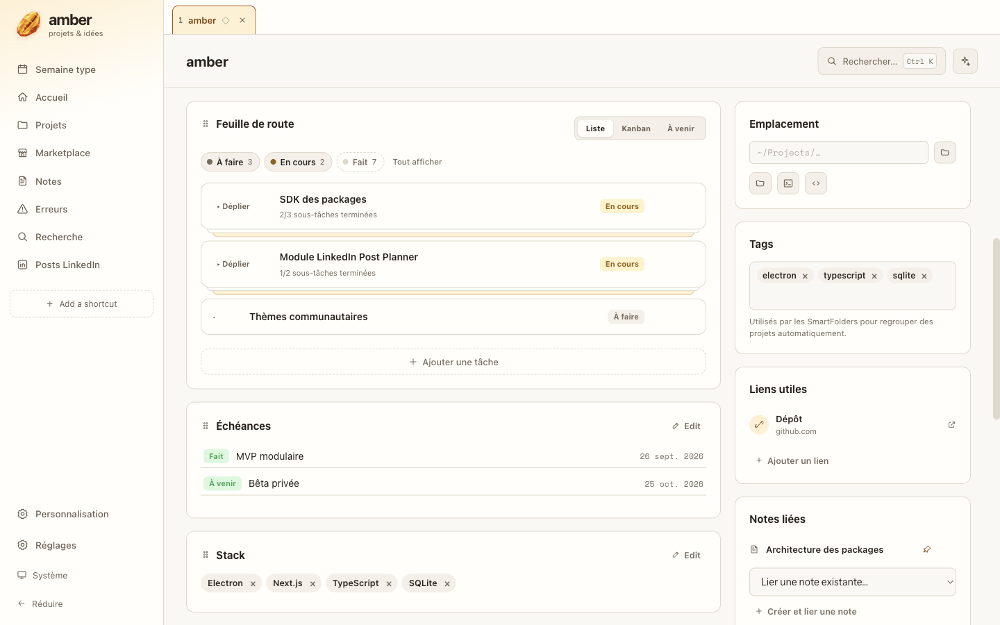
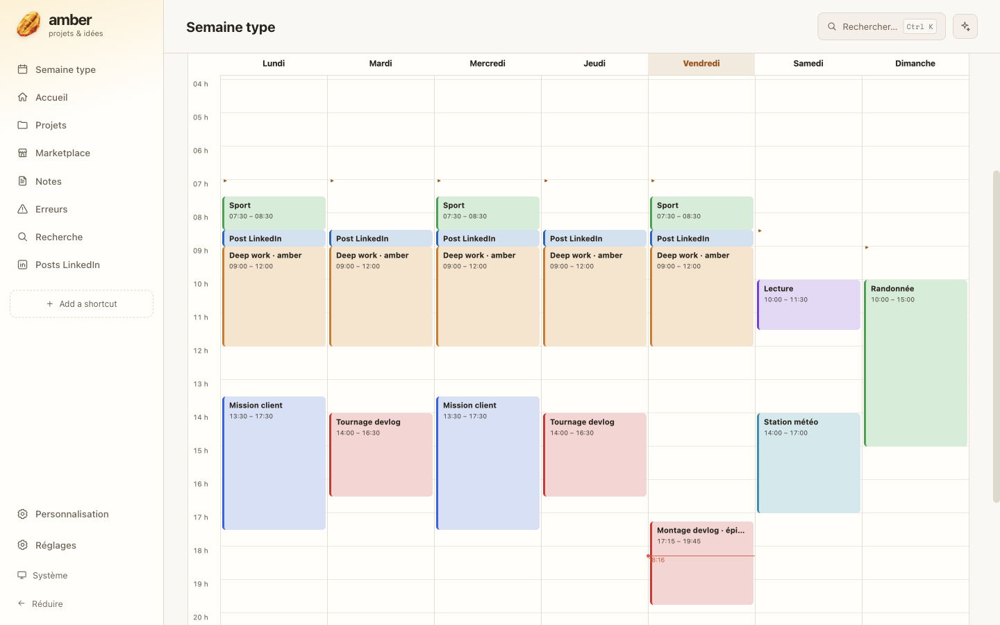
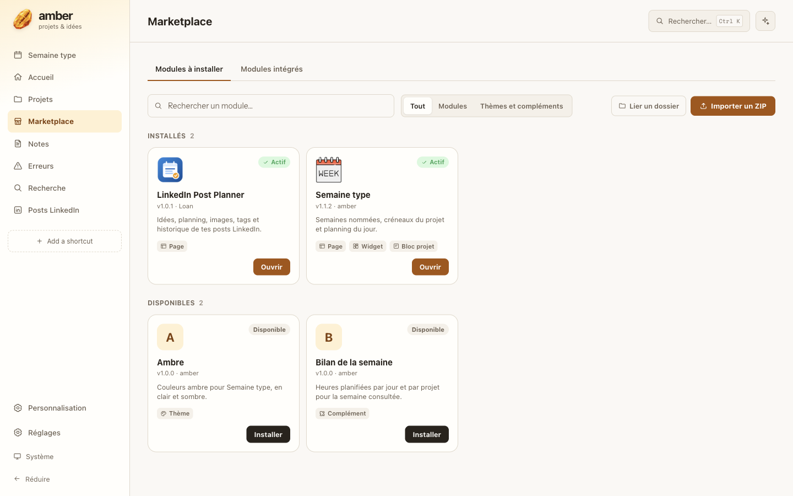
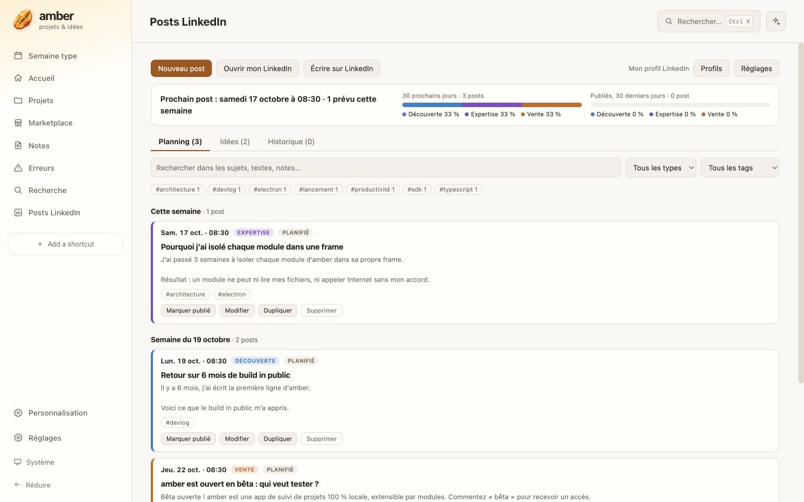
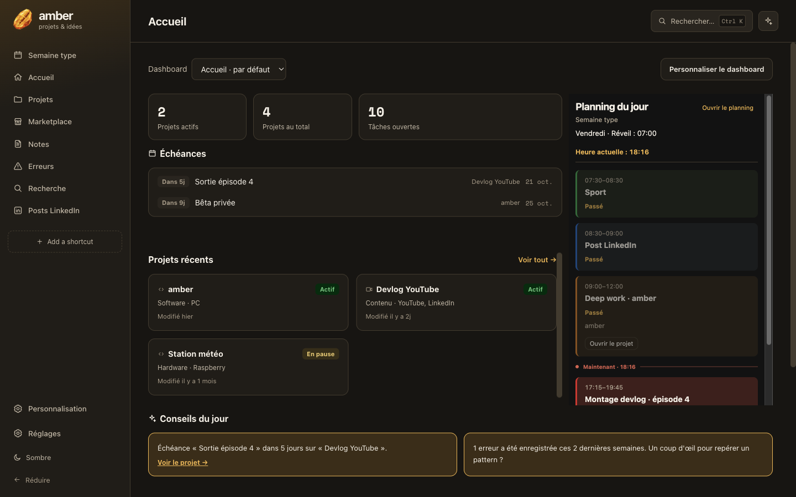
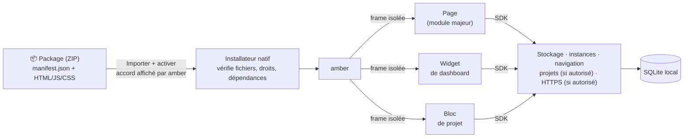

<p align="center"></p>

<h1 align="center">amber</h1>

<p align="center">
  <strong>Ton QG de projets perso, 100 % local et extensible par modules.</strong><br>
  Projets, tâches, échéances, notes, semaine type… et tout ce que tu veux y ajouter.
</p>

<p align="center">
  
</p>

> [!WARNING]
> **Projet personnel en développement actif.** L'interface, le format des données et le SDK peuvent encore changer.

---

## Pourquoi amber ?

- 🗂️ **Un seul endroit** pour tes side projects : feuille de route, échéances, achats, notes, erreurs déjà résolues.
- 🔒 **Tes données restent chez toi.** Une base SQLite locale, aucun compte, aucun serveur. Les modules n'accèdent à Internet que si tu l'autorises.
- 🧩 **Extensible.** Une fonctionnalité qui manque ? C'est un module : un ZIP qu'on importe en un clic, qui ne peut ni lire tes fichiers ni casser l'app.
- 🗓️ **Pensé pour avancer.** Semaine type, planning du jour avec progression, conseils, tâches en liste ou en kanban.

## Un aperçu

### Des projets qui avancent
Feuille de route avec sous-tâches, vue Kanban, échéances, stack, liens, notes liées, graphiques. Chaque projet est composé de **blocs** que tu ajoutes, déplaces et renommes.

<p align="center"></p>

### Ta semaine type, en un coup d'œil
Glisse dans le vide pour créer un créneau, déplace-le, étire-le. Les réveils se règlent sur le bord de chaque journée. Plusieurs semaines nommées (cours, vacances…) et un widget « planning du jour » avec le créneau en cours sur l'accueil.

<p align="center"></p>

### Des modules à la carte
Le **Marketplace** montre une carte par module, avec **un statut** (Actif, À activer, Mise à jour…) et **un seul bouton** pour l'étape suivante. Importer un ZIP l'installe et l'active, chaque étape confirmée par amber.

<p align="center"></p>

### Exemple : LinkedIn Post Planner
Un module complet construit avec le SDK : idées avec `#tags`, posts Découverte / Expertise / Vente, planning par semaine, image, aperçu de l'accroche, historique et rappel « publié ? » quand l'heure est passée.

<p align="center"></p>

### Clair ou sombre
<p align="center"></p>

## Ce que tu peux faire

| | |
| --- | --- |
| **Projets** | Statut, catégories, dossiers et SmartFolders, onglets épinglables (`⌘1`…`⌘9`), blocs : tâches (liste, kanban, à venir), échéances, checklist d'achats/événements, table, graphique, stack, image/texte, note ou erreur épinglée. |
| **Notes & erreurs** | Notes Markdown liées aux projets, corbeille avec restauration ; journal d'erreurs avec causes et solution. |
| **Accueil** | Dashboards personnalisables : déplace et redimensionne les widgets, crée plusieurs dashboards. |
| **Sidebar** | Shortcuts vers n'importe quelle page, dashboard ou module, rangés en groupes repliables, avec 54 icônes. |
| **IA (optionnelle)** | Créer ou ajuster un projet, une note ou une erreur en langage naturel, via le programme de ton choix (voir plus bas). |
| **Sauvegarde** | Sauvegarde vérifiée, restauration, démarrage sans modules tiers, diagnostic exportable. |

## Comment fonctionnent les modules

amber est un **socle** (projets, notes, dashboards, sidebar) autour duquel viennent se brancher des **packages**.



**Un package** est un ZIP avec un `manifest.json` et des fichiers web déjà compilés. Il peut apporter trois types de **contributions** :

| Contribution | Où elle apparaît | Exemple |
| --- | --- | --- |
| 📄 **Page** (module majeur) | Page entière, ouverte depuis un shortcut | Le calendrier de Semaine type |
| ▦ **Widget** | Sur un dashboard | « Planning du jour » |
| ▤ **Bloc projet** (module mineur) | Dans la page d'un projet | « Créneaux du projet » |

Une page peut gérer plusieurs **instances** (ex. « Semaine école » et « Semaine vacances », ou un profil LinkedIn perso et un pro). Chaque widget ou bloc suit l'instance active ou une instance précise.

**Sécurité par défaut.** Chaque contribution tourne dans une frame isolée : pas d'accès aux fichiers, à Node, au réseau ni au reste de l'interface. Elle ne parle à amber que par le **SDK** :

```js
const sdk = await ProjectTracker.ready
const doc = await sdk.storage.get({ scope: 'instance', collection: 'posts', id: 'p1' })
await sdk.storage.put({ scope: 'instance', collection: 'posts', id: 'p1', value, expectedRevision: doc?.revision ?? null })
```

Les droits supplémentaires (lire tes projets, joindre `https://api.exemple.com`, lire les données d'un autre package) sont **déclarés dans le manifeste** et **acceptés par toi** à l'installation. Désactiver ou désinstaller un module **conserve ses données**.

Aussi : des **thèmes** (couleurs d'un package ou de l'app) et des **compléments** qui s'insèrent dans un emplacement prévu par un autre module (ex. le « Bilan de la semaine » sous Semaine type).

## Créer ton propre module

1. Lis le **[guide de création de modules](docs/packages/CREER-UN-MODULE.md)** : un exemple complet (widget compteur), le manifeste, le SDK, le stockage, les instances, les droits et une checklist.
2. Écris ton `manifest.json`, ton HTML et ton JS (TypeScript/React possible, compilé pour le navigateur).
3. Produis le ZIP, puis **Marketplace → Importer un ZIP**.

Le module LinkedIn de ce dépôt est un exemple réel : [`packages/linkedin-post-planner`](packages/linkedin-post-planner/README.md).

```bash
npm run build:local                             # construit l'app (vide dist/)
node scripts/build-linkedin-planner-package.mjs # → dist/packages/lfantine.linkedin-post-planner-1.0.1.zip
npm run start:local                             # puis Marketplace → Importer un ZIP
```

Référence détaillée : [format des packages](docs/packages/FORMAT.md) · [registre](docs/packages/REGISTRY.md) · [installateur](docs/packages/INSTALLER.md).

## Installation

amber est une app de bureau **macOS (Apple Silicon)** construite avec Electron et Next.js.

```bash
pnpm install          # dépendances
pnpm dev              # mode développement (modules externes désactivés)
npm run build:local   # app personnelle : dist/mac-arm64/amber.app
npm run start:local   # la lancer
```

- Tes données sont dans `~/.data/amber/` (SQLite + JSON historiques conservés). Un ancien dossier `~/.data/ProjectTracker/` est renommé automatiquement au premier lancement de l'app construite, si `~/.data/amber/` n'existe pas encore. La migration depuis les anciennes versions se fait au premier lancement de l'app construite.
- Les modules externes ne s'exécutent que dans l'app construite (`build:local`), pas en mode `dev`.
- `npm run build:mac` produit un DMG + ZIP non signés. Détails et limites : [distribution](docs/packages/LOT8-PROGRESS.md), [récupération](docs/storage/RECOVERY.md).

### Configurer l'IA (optionnel)

amber n'appelle aucune API d'IA directement. Il exécute **un programme en ligne de commande de ton choix** (par défaut `groqtool`) avec `--request "<texte>"` (et parfois `--format "<texte>"`), et lit sa réponse sur la sortie standard. Choisis-le dans **Réglages → Intelligence artificielle**.

## Pour les développeurs

| Commande | Rôle |
| --- | --- |
| `npm test` | Vitest (logique, interface, services natifs) + scénarios de régression |
| `npm run typecheck` | TypeScript de chaque couche (shared, main, preload, renderer, sdk, packages) |
| `npm run test:runtime` | Runtime isolé des modules dans Chromium |
| `node scripts/e2e.mjs --build` | Parcours Electron complets (reconstruit `app/` et vide `dist/`) |
| `npm run screenshots` | Régénère les captures de ce README depuis `app/`, avec des données d'exemple |

Tous les tests et les captures utilisent des **répertoires jetables** ; ton répertoire personnel est vérifié avant et après.

```
main/        Processus Electron : SQLite, installateur et runtime des modules, IA
renderer/    Interface Next.js (pages, composants, état)
shared/      Contrats communs : manifeste, SDK, icônes, limites, schéma JSON publié
sdk/         SDK des modules (côté frame) et hôte des frames (côté app)
packages/    Modules du dépôt : Semaine type, Bilan, thème Ambre, LinkedIn Post Planner
scripts/     Builds (app, ZIP de modules), tests, captures
docs/        Format des modules, guide de création, stockage et récupération
PLANS/       Notes de travail locales (ignorées par Git)
```

Stack : Electron + [Nextron](https://github.com/saltyshiomix/nextron), Next.js + React, TypeScript, Tailwind, SQLite (`node:sqlite`), Vitest et Playwright.
