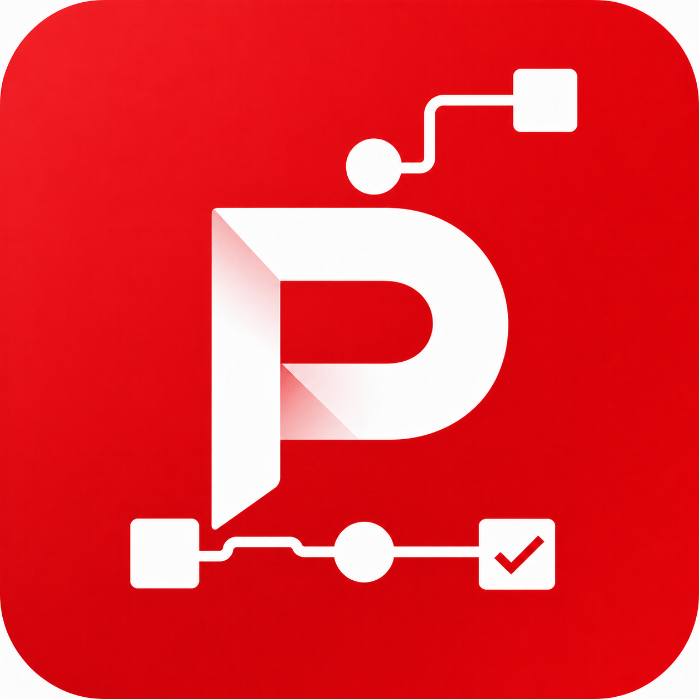
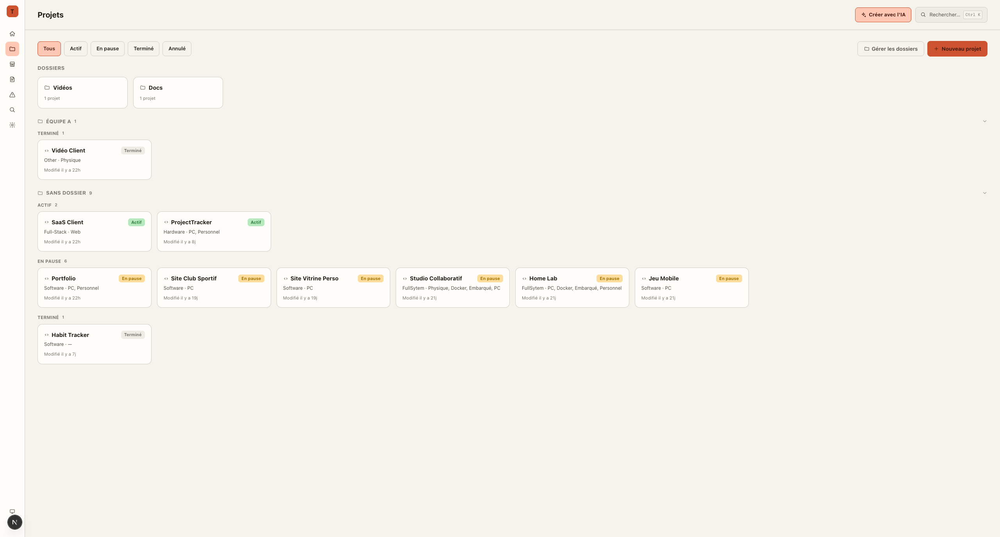
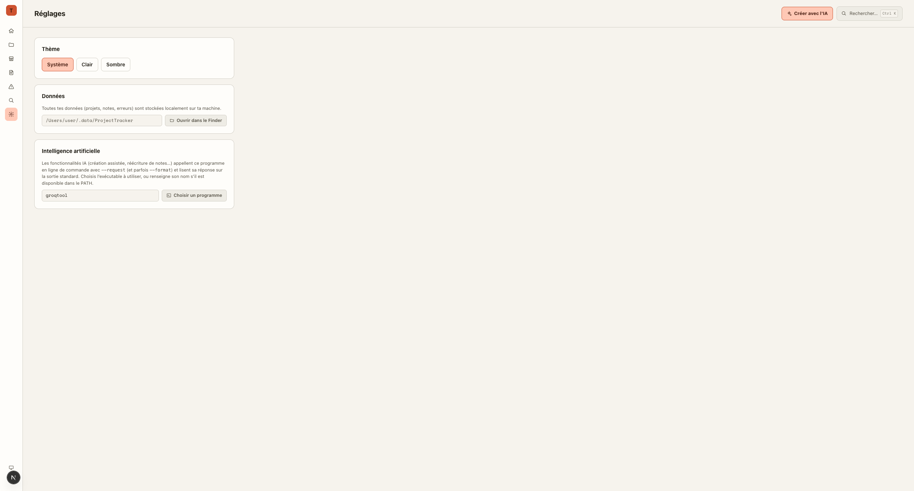

<p align="center"></p>

<h1 align="center">Project Tracker</h1>

<p align="center">
  Une app de bureau (Electron + Next.js) pour suivre tes projets perso : tâches, deadlines, notes, erreurs, checklists d'achat… le tout dans une seule fenêtre.
</p>

> [!WARNING]
> **Projet en développement actif.** Les fonctionnalités, le format des données et l'interface peuvent changer sans préavis. À utiliser en connaissance de cause.

## Aperçu

| Accueil | Projets | Réglages |
| --- | --- | --- |
|  |  |  |

*(Captures avec des données d'exemple.)*

## Ce qu'il faut savoir

### 🔒 Toutes les données restent en local

Aucune donnée n'est envoyée sur un serveur. Projets, notes, erreurs, checklists : tout est stocké dans un simple fichier JSON sur ta machine (`~/.data/ProjectTracker/data.json`), visible et modifiable directement depuis les Réglages de l'app (bouton "Ouvrir dans le Finder").

### 🤖 L'IA passe par un programme externe, au choix

Les fonctionnalités assistées par IA (création guidée de projets/notes/erreurs, réécriture de notes…) n'appellent aucune API directement depuis l'app. Elles délèguent l'appel à un **programme en ligne de commande configurable**, invoqué avec `--request "<texte>"` (et parfois `--format "<texte>"`), dont la réponse est lue sur la sortie standard.

Tu choisis ce programme dans **Réglages → Intelligence artificielle** : un champ texte (nom d'un binaire dans le `PATH`, ou chemin complet) plus un bouton pour le sélectionner directement via un sélecteur de fichier. Par défaut, l'app s'attend à trouver un outil nommé `groqtool`, mais n'importe quel exécutable respectant ce contrat d'appel peut être utilisé à la place.

### 🚧 En développement

Ce projet est un outil personnel en construction. Attends-toi à des changements de structure, des bugs, et des fonctionnalités incomplètes.

## Stack

- [Electron](https://www.electronjs.org/) + [Nextron](https://github.com/saltyshiomix/nextron) — coquille bureau
- [Next.js](https://nextjs.org/) + React — interface (dossier `renderer/`)
- TypeScript de bout en bout (processus principal `main/` et interface `renderer/`)
- Aucune base de données, aucun backend : un fichier JSON local (`main/helpers/data-store.ts`)

## Installation

```bash
# installer les dépendances
pnpm install

# lancer en mode développement
pnpm dev

# build de production
pnpm build
```

## Configuration de l'IA

1. Ouvre **Réglages** dans l'app.
2. Dans la section **Intelligence artificielle**, renseigne le nom ou le chemin du programme à exécuter (par défaut `groqtool`), ou clique sur **Choisir un programme** pour le sélectionner via l'explorateur de fichiers.
3. Ce programme doit accepter `--request <texte>` (et optionnellement `--format <texte>`) et écrire sa réponse sur `stdout`.

## Structure du projet

```
main/                 Processus principal Electron (IPC, stockage local, appel du programme IA)
renderer/             Interface Next.js (pages, composants, state)
resources/            Icônes, assets de design, captures d'écran
```
